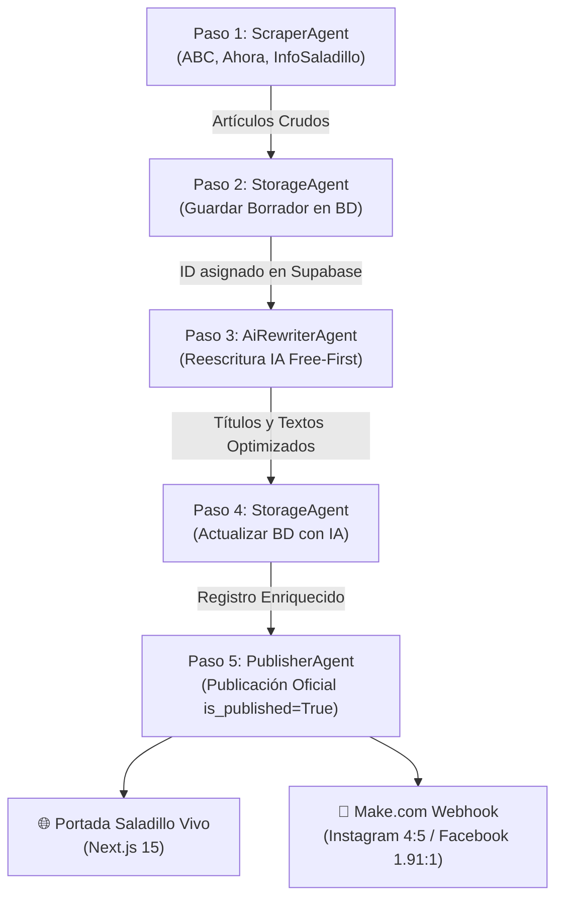

# Saladillo Vivo Pro — Documentación de Arquitectura y Especificación Técnica del Sistema (`scraping.md`)

> **Propósito de este documento**: Proveer un compendio exhaustivo y de nivel técnico de toda la plataforma **Saladillo Vivo** (Next.js 15, React 19, Supabase, TailwindCSS, Zustand) y su **Sistema Autónomo de Automatización de Noticias Multi-Agente**. Este archivo sirve como base de conocimiento, fuente de verdad y contexto maestro para que un agente de Inteligencia Artificial (o desarrollador) pueda redactar prompts precisos, planificar refactorizaciones o programar futuras ampliaciones sin degradar las características críticas de la plataforma (reproducción "TV-Grade", anti-branding de YouTube, estado desacoplado y optimizaciones de base de datos).

---

## 1. Visión General del Proyecto

**Saladillo Vivo** es una plataforma de streaming temático y portal hiperlocal de noticias, cultura y eventos del partido de Saladillo (Buenos Aires, Argentina). La aplicación fusiona la experiencia de un portal de noticias digital moderno con un canal de televisión continuo ("TV-Grade Live Streaming"), ofreciendo emisión ininterrumpida de video, clips a demanda, noticias interactivas con locución y diapositivas multimedia (.html), agenda de eventos, pronóstico del tiempo y automatizaciones de redes sociales.

### Principios Fundamentales de Diseño
1. **Continuidad Televisiva ("TV-Grade Broadcast")**: La reproducción nunca debe mostrar cortes abruptos ("Zero-Black"), demoras perceptibles ni pantallazos de carga.
2. **Anti-Branding Cinematográfico**: Toda fuente externa de streaming (principalmente YouTube) debe ser enmascarada para eliminar logotipos, títulos nativos, marcas de agua, barras de controles y sugerencias de videos externos.
3. **Multi-Dispositivo Reactivo**: Adaptación de interfaz según el dispositivo y entorno (Desktop, Smart TV con control remoto, dispositivos móviles y PWA instalable).
4. **Rendimiento y Eficiencia de Red**: Consumo selectivo de datos en Supabase a través de vistas y Funciones Almacenadas (RPC), reduciendo cargas masivas de datos a payloads mínimos (< 5% del volumen bruto).
5. **Autonomía Periodística Multi-Agente**: Extracción, procesamiento y publicación de noticias en un ciclo desacoplado de 5 fases continuas sin intervención manual.

---

## 2. Stack Tecnológico

| Capa | Tecnologías / Librerías | Versión / Detalle |
| :--- | :--- | :--- |
| **Framework Web** | Next.js (App Router, Server Components & Server Actions) | `^15.0.0` |
| **Librería UI** | React / React DOM | `^19.0.0` |
| **Lenguaje** | TypeScript / Python 3 | `TypeScript ^5.0.0`, `Python >=3.10` |
| **Estilos y CSS** | TailwindCSS, `tailwindcss-animate`, `postcss`, `clsx`, `tailwind-merge` | `3.4.17` |
| **Base de Datos & Backend** | Supabase (PostgreSQL, Row Level Security, PostgREST API, Storage, Auth) | `@supabase/supabase-js ^2.58.0` |
| **Gestión de Estado Global** | Zustand con middleware de `devtools` | `^5.0.11` |
| **Animaciones y Transiciones** | Framer Motion & GSAP | `framer-motion ^12.23.24`, `gsap ^3.14.2` |
| **Componentes Accesibles** | Radix UI (`@radix-ui/react-dialog`, `slider`, `progress`, `toast`, `slot`) | Primitivos Headless |
| **Reproductores Multimedia** | React-Player, Plyr, Plyr-react, HTML5 Video & Audio APIs | `react-player ^2.16.1`, `plyr ^3.8.3` |
| **Carruseles y Sliders** | Swiper | `swiper ^12.0.2` |
| **Iconografía** | Lucide React | `lucide-react ^0.544.0` |
| **Generación de Medios / OG** | `@vercel/og`, Sharp | `@vercel/og ^0.8.5`, `sharp ^0.34.4` |
| **Feeds y Sindicalización** | RSS, XML manual | `rss ^1.2.2` |
| **PWA & Offline** | Workbox, Service Workers | Generación en build |
| **Herramientas de Audio CLI** | Node.js, `yt-dlp`, FFmpeg (loudnorm), Deno | Script `normalize-loudness.js` |
| **IA & Reescritura** | GLM-4 (Zhipu AI), Google Gemini (1.5-flash), OpenAI (GPT-4o-mini) | Enfoque Free-First con Fallback Local |
| **Hosting & DNS** | Vercel (Edge Network / Node.js 24) + Cloudflare (Proxy SSL/TLS Full) | Dominios: `saladillovivo.com.ar` y `www` |

---

## 3. Arquitectura de Rutas y Middleware

La aplicación corre sobre el **Next.js App Router** dentro del directorio `src/app`.

### 3.1. Enrutamiento y Middleware Dinámico (`src/middleware.ts`)
> [!IMPORTANT]
> El archivo `middleware.ts` debe residir estrictamente en `src/middleware.ts` para ser compatible con Next.js 15 y el empaquetador ESM en Node.js 24 en Vercel.

El middleware intercepta las peticiones evaluando el `User-Agent` del cliente y el subdominio objetivo:
- **Detección de Smart TV**: Agentes que contienen `TV|Large Screen|SmartTV|GoogleTV|AppleTV|HbbTV|CrKey|Tizen|WebOS`. Redirige a `https://tv.saladillovivo.com.ar`.
- **Detección Móvil**: Agentes `Android|iPhone|iPad|iPod|BlackBerry|IEMobile|Opera Mini` (excluyendo TV). Redirige a `https://m.saladillovivo.com.ar`.
- **Detección Desktop**: Dispositivos estándar de escritorio. Redirige a `https://www.saladillovivo.com.ar`.
- **Exclusiones del Matcher**: Archivos estáticos (`_next/static`, `_next/data`, `_next/image`, `favicon.ico`, imágenes, sitemaps y rutas `/api`).

### 3.2. Estructura de Páginas y Vistas
- **`/` (`src/app/page.tsx`)**:
  - Página de inicio (SSR con ISR `revalidate = 60`).
  - Obtiene en paralelo: noticias de portada (`getArticlesForHome`), videos priorizados (`getVideosForHome`), textos para el zócalo (`getTickerTexts`), entrevistas, anuncios publicitarios activos (`getActiveAds`), banners (`getActiveBanners`) y eventos del calendario (`getCalendarEvents`).
  - **Deep Linking**: Si la URL contiene `?v={id}` o `?url={videoUrl}`, busca dicho video y lo inyecta como elemento de máxima prioridad para su reproducción inmediata.
- **`/noticia/[slug]` (`src/app/noticia/[slug]/page.tsx`)**:
  - Vista individual de noticia (`revalidate = 60`).
  - `generateMetadata`: Extrae título, descripción e imagen OpenGraph (`1200x628`) para previsualizaciones sociales dinámicas (Twitter/X, Facebook, WhatsApp).
  - Consulta a Supabase por `slug`. Si no existe, invoca `notFound()`.
  - Renderiza `NoticiaClient` con cuerpo de la nota, reproductor de audio adjunto (`audio_url`), imágenes y notas relacionadas.
- **`/categoria/[categoria]` (`src/app/categoria/[categoria]/page.tsx`)**:
  - Listado de noticias filtradas por estado o etiqueta temática.
  - Implementa `generateStaticParams` para pre-generar las categorías existentes.
  - Renderiza `CategoryPageClient`.
- **`/sitemap.xml`**: Mapa del sitio dinámico para motores de búsqueda.
- **`/rss.xml` (`src/app/rss.xml/route.ts`)**: Feed estándar RSS 2.0 de las últimas noticias para lectores de feeds.

### 3.3. Rutas de API y Endpoints de Automatización
- **`/api/check-stream` (`src/app/api/check-stream/route.ts`)**:
  - Verifica si una emisión en vivo está activa sin depender de la cuota de la YouTube Data API.
  - Para YouTube: Realiza un fetch con User-Agent emulado y escanea el contenido en busca de las señales `"isLive":true`, `"isLiveNow":true` o insignias de directo.
  - Para HLS (`.m3u8`): Comprueba que el archivo de lista de reproducción no contenga la etiqueta `#EXT-X-ENDLIST`.
- **`/api/revisar-noticias` (`src/app/api/revisar-noticias/route.ts`)**:
  - Tarea tipo Cron protegida por cabecera `Authorization: Bearer CRON_SECRET`.
  - Consulta en Supabase noticias listas para emitir (`is_published = false`, `publish_at <= now()`, con miniaturas generadas).
  - Despacha un payload Webhook a Make.com (para automatizar publicaciones en Instagram y Facebook con imágenes en proporciones 4:5 y 1.91:1).
  - Al recibir respuesta `200 OK`, actualiza la noticia a `is_published = true`.
- **`/feed/miniaturas` (`src/app/feed/miniaturas/route.ts`)**:
  - Feed Media RSS (`mrss`) generado bajo demanda (`dynamic = 'force-dynamic'`).
  - Formatea artículos programados con etiquetas `<media:content>` que incluyen dimensiones para Instagram (1080x1350) y Facebook (1200x628).
- **`/api/og` (`src/app/api/og/route.tsx`)**:
  - Generador dinámico de banners OpenGraph mediante la biblioteca `@vercel/og` y JSX sobre el Edge Runtime.
- **`/api/generate-image` (`src/app/api/generate-image/route.ts`)**:
  - Endpoint de procesamiento gráfico auxiliar para generación de artes y miniaturas.

---

## 4. Estructura de la Base de Datos (Supabase / PostgreSQL)

### 4.1. Esquema Completo de la Tabla `articles`
La tabla `articles` es el núcleo editorial de la plataforma:

| Campo | Tipo PostgreSQL | Descripción |
| :--- | :--- | :--- |
| `id` | `bigint` (Identity / Serial) | Clave primaria autonumérica asignada por PostgreSQL. |
| `title` | `text` | Título principal de la noticia (optimizado por IA o de la fuente). |
| `text` | `text` | Cuerpo completo del artículo reestructurado en párrafos. |
| `description` | `text` | Bajada o copete periodístico (resumen de 150-300 caracteres). |
| `slug` | `text` (Unique) | Slug amigable para URL (ej: `continuan-a-buen-ritmo-las-obras...`). |
| `image_url` | `text` | URL de la imagen principal del artículo. |
| `thumbnail_url` | `text` | Imagen optimizada para vistas en tarjeta. |
| `og_image_url` | `text` | Imagen horizontal proporción 1.91:1 (1200x628) para OpenGraph y Facebook. |
| `miniatura_url` | `text` | Imagen vertical proporción 4:5 (1080x1350) para Instagram. |
| `featureStatus` | `text` | Prioridad editorial: `'featured'` (destacada principal), `'secondary'` (secundaria), `'tertiary'` (terciaria), o `null`. |
| `status` | `text` | Estado del pipeline: `'draft'` (borrador ingestado), `'ai_processed'` (enriquecido con IA), `'published'` (publicado). |
| `is_published` | `boolean` | `false` durante ingesta y edición; `true` cuando está visible al público en la web. |
| `published_at` | `timestamptz` | Fecha/hora oficial de publicación efectiva para ordenamiento cronológico. |
| `publish_at` | `timestamptz` | Fecha/hora programada de difusión en redes sociales (Make.com). |
| `created_at` | `timestamptz` | Fecha de creación del registro. |
| `updatedAt` | `timestamptz` | Fecha de última modificación por IA o edición humana. |
| `meta_title` | `text` | Título SEO optimizado para buscadores. |
| `meta_description` | `text` | Meta descripción SEO (máximo 160 caracteres). |
| `meta_keywords` | `text` | Lista de etiquetas separadas por coma (ej: `"Saladillo, Obras, Seguridad"`). |
| `autor` | `text` | Firma de la nota (default: `'Equipo Editorial'`). |
| `categoria` | `text` | Categoría temática (`'Local'`, `'Deportes'`, `'Cultura'`, etc.). |
| `audio_url` | `text` (Nullable) | URL del archivo MP3/WAV con la locución radial de la noticia. |
| `url_slide` | `text` (Nullable) | URL de archivo `.html` para emitir la noticia en el reproductor de video. |
| `animation_duration` | `numeric` (Nullable) | Duración en segundos de la diapositiva en video. |

### 4.2. Consulta de Portada (`getArticlesForHome` en `src/lib/data.ts`)
Para optimizar el ancho de banda y la velocidad de carga de la portada, la consulta en Next.js excluye el campo pesado `text`:
```sql
SELECT id, title, image_url, featureStatus, updatedAt, created_at, slug, description,
       meta_title, meta_description, meta_keywords, published_at, audio_url, url_slide, animation_duration
FROM articles
WHERE (published_at IS NULL OR published_at <= NOW())
  AND created_at >= (NOW() - INTERVAL '48 HOURS')
ORDER BY created_at DESC
LIMIT 25;
```

---

## 5. Arquitectura de Reproducción "TV-Grade" y Anti-Branding

La seña de identidad de Saladillo Vivo es su motor de reproducción multimedia con estándares de transmisión televisiva.

### 5.1. Sistema de Capas "Cinematic Shield" y Z-Index
YouTube impone elementos de interfaz no deseados (título, avatar de canal, botones de compartir, sugerencias al pausar). Para garantizar una experiencia de canal de televisión, se aplica la estrategia **Cinematic Shield**:
1. **Z-0 (`ReactPlayer` / YouTube iFrame)**: Escalado con sobremedida y contenedor sin eventos directos de cursor (`pointer-events-none`).
2. **Z-10 (`Cinematic Bars`)**: Franjas negras letterbox superiores e inferiores que tapan barras de progreso o textos nativos del player.
3. **Z-20 (`VideoTitleBar` / `CustomControls`)**: Controles propios desarrollados con Radix y Lucide React, desplegando tipografía institucional y metadata propia.
4. **Z-30 (`Intro Overlay / Pre-Roll Layer`)**: Videos breves institucionales (`/videos_intro/intro1.mp4` a `intro5.mp4` o placas de "Espacio Publicitario") que se colocan encima de la reproducción durante 3 segundos ("Safety Delay"). Mientras la intro se reproduce sobre el usuario, el iframe de YouTube de fondo inicia el buffering y los controles nativos desaparecen antes de que la intro se retire con un fade.

### 5.2. Transiciones Zero-Black ("Cover First, Swap Later")
- **Problema habitual**: Desmontar el player anterior causa un pantallazo negro visible de 1 a 2 segundos mientras el nuevo recurso se conecta.
- **Solución implementada**:
  - Al solicitar un cambio de video, la capa de transición (Intro o Slide) se despliega al 100% de opacidad sobre el video en curso.
  - El video saliente sigue reproduciéndose por debajo durante ~800 ms (**Safety Delay**).
  - Recién cuando la capa superior es totalmente opaca y sólida, se conmuta el contenido del reproductor subyacente.
  - Al concluir la transición, la capa superior realiza un Fade-Out de 0.75s revelando el nuevo contenido ya iniciado y fluido.

### 5.3. Noticias Interactivas (.html Slides) y Locución
Las noticias pueden ser emitidas como piezas televisivas animadas:
1. Si un artículo cuenta con `url_slide` (archivo que finaliza en `.html`), el `useNewsPlayerStore` dispara el slide.
2. El video de fondo se pausa automáticamente guardando su posición en segundos (`pauseForSlide`).
3. El slide se despliega en pantalla completa o sobre el contenedor de video.
4. Si la noticia posee `audio_url`, se reproduce en paralelo con un elemento `<audio>` sincronizado.
5. Al completarse la duración del slide o terminar el audio, el reproductor de video de fondo se reactiva de forma transparente (`resumeAfterSlide`).

---

## 6. Sistema de Automatización de Noticias Multi-Agente (Arquitectura de 5 Pasos)

La plataforma dispone de un motor autónomo desarrollado en Python (`agents/` y scripts raíz) que ejecuta de forma desacoplada y secuencial el ciclo completo de noticias:



### 6.1. Agente 1: `ScraperAgent` (`agents/scraper_agent.py`)
- **Portales Monitoreados**:
  - **ABC Saladillo**: `https://www.abcsaladillo.com.ar`
  - **Ahora Saladillo**: `https://ahorasaladillo-diariodigital.com.ar`
  - **InfoSaladillo**: `https://infosaladillo.com.ar`
- **Técnicas Anti-Bloqueo**:
  - Rotación pseudo-aleatoria de User-Agents modernos (Chrome 122, Edge 121, Safari macOS).
  - Delays de cortesía entre peticiones HTTP (1.0 a 2.5 segundos) para no saturar los servidores de origen.
  - Filtrado de exclusiones para descartar enlaces no periodísticos (`/farmacias-de-turno`, `/contacto`, `/tag/`, redes sociales).
- **Extracción de Contenido**:
  - Parser HTML nativo basado en `html.parser` y expresiones regulares.
  - Extrae: título limpio, cuerpo de párrafos concatenados, imagen destacada (`og:image` o primera imagen de nota), fecha y URL canónica.
  - Genera hash MD5 de la URL canónica para deduplicación local en `data/scraped_articles.json`.

### 6.2. Agente 2: Ingesta en Base de Datos como Borrador (`StorageAgent.save_draft`)
- Toma el artículo extraído y lo registra inmediatamente en la tabla `articles` de Supabase:
  - `status`: `'draft'`
  - `is_published`: `false`
  - `title`: Título original de la fuente.
  - `text`: Texto original de la fuente.
  - `description`: Bajada preliminar.
  - `slug`: Slug generado algorítmicamente asegurando no colisión.
  - `image_url`, `thumbnail_url`, `og_image_url`: Imagen original.
  - `created_at`: Fecha y hora actual.
- **Deduplicación de Slugs**:
  - Función `generate_unique_slug(title)`: Consulta en Supabase con PostgREST `slug=eq.{slug}&limit=1`.
  - Si colisiona, añade sufijos incrementales (`-1`, `-2`, etc.) hasta encontrar un slug libre.
- **Manejo de Esquema**:
  - Si alguna columna no existe en el PostgREST Schema Cache (código HTTP 400), la función detecta el nombre de la columna y reintenta automáticamente descartando dicho campo sin interrumpir el flujo.
- **Captura de ID**: Recupera y retorna el `id` autonumérico generado por PostgreSQL para vincularlo a las fases siguientes.

### 6.3. Agente 3: Reestructuración y Modificación con IA (`AiRewriterAgent`)
- Aplica el enfoque **Free-First** (máxima calidad y coste cero garantizado):
  1. **GLM-4 (Zhipu AI / Z.AI)**: Proveedor primario, alta cuota gratuita permanente y rápida respuesta en español.
  2. **Google Gemini (gemini-1.5-flash)**: Proveedor secundario, veloz y gratuito.
  3. **OpenAI (gpt-4o-mini)**: Proveedor terciario comercial de respaldo.
  4. **Fallback Heurístico Periodístico Local**: Mecanismo de emergencia local que garantiza continuidad operativa si fallan las redes o se agotan las cuotas. Reestructura el texto bajo normas periodísticas (Lead + Desarrollo + Cierre), genera metadatos y añade prefijos hiperlocales (`"Saladillo: ..."`).
- **Prompt Hiperlocal Especializado**:
  - Reestructura la noticia sin alterar hechos, nombres, fechas ni cifras.
  - Genera título periodístico digital atractivo.
  - Produce un copete/lead informativo de 150-300 caracteres.
  - Formula meta descripción SEO (máximo 155 caracteres) y etiquetas locales (`palabras_clave`).
- **Scoring Editorial Automático (`calculate_priority_score`)**:
  - Relevancia hiperlocal ("Saladillo", obras, comunidad): +2 puntos.
  - Palabras de alto impacto ("inversión", "alerta", "inauguración", "oro", "campeón"): +2 puntos.
  - Presencia de imagen válida: +1 punto.
  - Extensión mayor a 400 caracteres: +1 punto.
  - **Clasificación**: `score >= 5` → `'featured'`, `score >= 3` → `'secondary'`, `score < 3` → `'tertiary'`.

### 6.4. Agente 4: Actualización en Base de Datos con IA (`StorageAgent.update_with_ai`)
- Ejecuta un `PATCH` sobre la API REST de Supabase filtrando por `id=eq.{article_id}`.
- Actualiza:
  - `title`: Título optimizado por IA.
  - `text`: Cuerpo reestructurado profesionalmente.
  - `description`: Copete editorial.
  - `meta_title`, `meta_description`: Metadatos SEO.
  - `meta_keywords`: Etiquetas en formato texto.
  - `featureStatus`: Prioridad calculada.
  - `status`: `'ai_processed'`.
  - `updatedAt`: Timestamp ISO actual.

### 6.5. Agente 5: Publicación Oficial y Distribución (`PublisherAgent`)
- Activa la visibilidad pública de la noticia:
  - `is_published`: `true`
  - `status`: `'published'`
  - `published_at`: Timestamp ISO actual.
  - `publish_at`: Timestamp ISO actual.
  - `miniatura_url` y `og_image_url`: Sincronizadas para previsualizaciones sociales.
- Con esta actualización:
  - Next.js 15 (`getArticlesForHome` con ISR 60s) indexa y renderiza la noticia de inmediato en la portada.
  - Los feeds RSS (`/rss.xml` y `/feed/miniaturas`) incorporan la noticia para los lectores y plataformas de agregación.

### 6.6. Orquestador y Planificación Horaria (`OrchestratorAgent`)
El orquestador (`complete_automation.py`) administra la frecuencia de ejecución según la franja horaria local de Argentina:

| Franja Horaria | Intervalo de Ejecución | Justificación Editorial |
| :--- | :--- | :--- |
| **07:00 a 12:00** | **Cada 30 minutos** | Horas pico matutinas con mayor flujo de novedades locales, apertura de oficinas y coberturas en vivo. |
| **12:00 a 22:00** | **Cada 1 hora** | Ritmo periodístico vespertino estándar. |
| **22:00 a 07:00** | **Cada 3 horas** | Guardia nocturna pasiva para registrar eventos de última hora minimizando consumo de recursos. |

---

## 7. Infraestructura de Producción, Despliegue y Dominios

### 7.1. Configuración de Vercel
- **Proyecto**: `autosaladillovivo`
- **Equipo**: `matias11972-saladillovivo` (`team_ct9TOpkXChXF9w5E0nVWQiAN`)
- **Preset de Framework**: `nextjs` (Obligatorio para enrutamiento perimetral correcto en Next.js 15).
- **Protección de Despliegues (SSO)**: `ssoProtection: null` (Desactivada para permitir acceso público universal sin login previo a Vercel).
- **Runtime**: Node.js 24.x con soporte de Serverless Functions en región `iad1` (Washington D.C., USA).
- **Variables de Entorno Clave en Producción**:
  - `NEXT_PUBLIC_SUPABASE_URL`: `https://otwvfihzaznyjvjtkvvd.supabase.co`
  - `NEXT_PUBLIC_SUPABASE_ANON_KEY`: Llave pública para lecturas en frontend.
  - `SUPABASE_KEY` / `SUPABASE_SERVICE_ROLE_KEY`: Llave de servicio para inserción y actualización por parte de los scripts y tareas programadas.
  - `CRON_SECRET`: Secreto criptográfico para autorizar el endpoint `/api/revisar-noticias`.
  - `MAKE_WEBHOOK_URL`: URL del escenario de Make.com para publicación en redes.

### 7.2. Configuración de Cloudflare y DNS
El dominio `saladillovivo.com.ar` opera detrás del proxy de Cloudflare (DNS proxied, nube naranja):
- **Modo SSL/TLS en Cloudflare**: Debe estar configurado en **"Full" o "Full (strict)"**. No utilizar "Flexible", ya que Vercel rechaza peticiones HTTP sin TLS en el puerto 80 devolviendo `404 NOT_FOUND` o `421 Misdirected Request`.
- **Ruteo de Nombres de Dominio**:
  - `saladillovivo.com.ar` (Apex): Redirige permanentemente (`308 Permanent Redirect`) hacia `www.saladillovivo.com.ar`.
  - `www.saladillovivo.com.ar` (Canónico): Registro CNAME hacia `cname.vercel-dns.com` o `a7ab0739941b2daa.vercel-dns-017.com`.
  - `autosaladillovivo.vercel.app`: Dominio nativo de Vercel para pruebas directas.

---

## 8. Guía Operativa y Comandos del Sistema de Automatización

### 8.1. Ejecutar el Ciclo Completo de 5 Pasos
Para ejecutar una sola pasada de extracción, borrador en BD, IA, actualización en BD y publicación:
```bash
python complete_automation.py --once
```

Para mantener el sistema corriendo continuamente en segundo plano con el planificador por franjas horarias:
```bash
python complete_automation.py
```

### 8.2. Ejecutar Módulos Aislados
- **Scraping Directo únicamente**:
  ```bash
  python simple_scraper.py --limit 10
  ```
- **Reescritura IA únicamente sobre artículos en `data/scraped_articles.json`**:
  ```bash
  python free_rewriter.py
  ```
- **Publicación directa a Supabase desde archivo local**:
  ```bash
  python publish_to_supabase.py --input data/modified_articles.json
  ```
- **Verificar conectividad con Supabase**:
  ```bash
  python publish_to_supabase.py --check-only
  ```

### 8.3. Monitoreo y Auditoría
- **Logs detallados del sistema**: [`logs/automation.log`](file:///d:/GEMINI-CLI/SALADILLOVIVO_NEXT/saladillo-vivo-pro/logs/automation.log)
- **Métricas del último ciclo**: [`data/cycle_summary.json`](file:///d:/GEMINI-CLI/SALADILLOVIVO_NEXT/saladillo-vivo-pro/data/cycle_summary.json)
- **Historial de artículos scrapeados**: [`data/scraped_articles.json`](file:///d:/GEMINI-CLI/SALADILLOVIVO_NEXT/saladillo-vivo-pro/data/scraped_articles.json)
- **Historial de artículos con IA**: [`data/modified_articles.json`](file:///d:/GEMINI-CLI/SALADILLOVIVO_NEXT/saladillo-vivo-pro/data/modified_articles.json)

---

## 9. Reglas Inviolables para Agentes de IA y Desarrolladores

Cuando un modelo de IA o un desarrollador modifique el sistema, debe acatar estrictamente estas directivas:

1. **NO alterar la arquitectura de video "TV-Grade"**:
   - Nunca modificar los archivos [`VideoPlayer.tsx`](file:///d:/GEMINI-CLI/SALADILLOVIVO_NEXT/saladillo-vivo-pro/src/components/VideoPlayer.tsx), [`VideoSection.tsx`](file:///d:/GEMINI-CLI/SALADILLOVIVO_NEXT/saladillo-vivo-pro/src/components/VideoSection.tsx), [`usePlayerStore.ts`](file:///d:/GEMINI-CLI/SALADILLOVIVO_NEXT/saladillo-vivo-pro/src/store/usePlayerStore.ts) ni [`useVolumeStore.ts`](file:///d:/GEMINI-CLI/SALADILLOVIVO_NEXT/saladillo-vivo-pro/src/store/useVolumeStore.ts).
   - Mantener intacto el sistema de transiciones Zero-Black con *Safety Delay* y las capas de blindaje *Cinematic Shield*.
2. **Respetar la secuencia de 5 pasos en noticias**:
   - Todo artículo debe pasar primero por un estado de borrador preliminar en base de datos (`status='draft'`, `is_published=false`) antes de ser enriquecido por IA y finalmente publicado.
3. **Mantener la compatibilidad Free-First**:
   - Toda llamada de IA debe priorizar modelos gratuitos (GLM / Gemini) antes de invocar APIs de pago, y siempre debe existir un fallback local algorítmico funcional que no bloquee el pipeline ante cortes de API externa.
4. **Respetar el esquema de PostgREST y la deduplicación de slugs**:
   - Todo nuevo registro debe verificar colisión previa de slugs.
   - En la consulta de portada en Next.js, nunca solicitar el campo pesado `text` para no degradar el First Contentful Paint (FCP).
5. **Garantizar compatibilidad con Node.js 24 en Vercel**:
   - El middleware debe conservarse en `src/middleware.ts` y usar únicamente módulos compatibles con el Edge Runtime o Node.js ESM.
